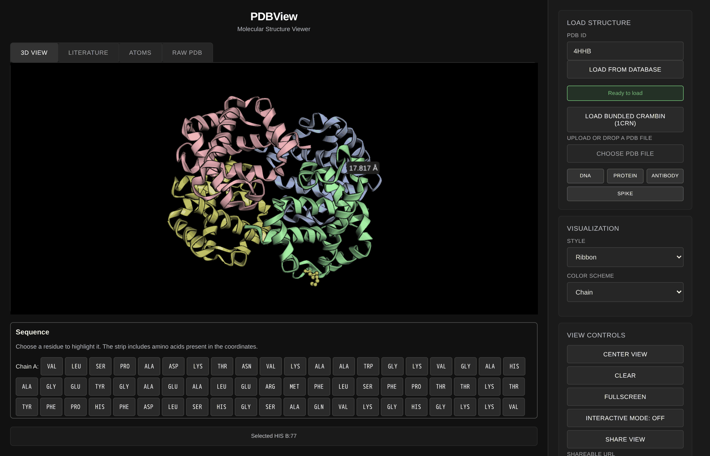

# pdbview

A PDB structure viewer for the browser, built on [3Dmol.js](https://3dmol.org/) with no build step. Give it an RCSB ID, such as [4HHB](https://mottopanikeiku.github.io/pdbview/?pdb=4HHB) for hemoglobin, or drop in a `.pdb` file, which stays on your machine. With no ID it opens crambin (1CRN).



Clicking a residue in the sequence strip highlights it in 3D. Picking two atoms gives their distance in ångströms. The structure draws as ribbon, stick, sphere, line or cross, colored by chain, residue or element, and other panels show the atom records, the raw PDB text and the entry's citations. The Share view button writes a link with the structure ID, style, camera, selection and measurement, so whoever opens it sees exactly what you saw.

The 3D view shows the first model and the A alternate location. Arrow keys rotate, `+` and `-` zoom, `C` centers.

## Running it

```sh
python3 -m http.server 8000
```

Then open `http://localhost:8000/`. The Playwright tests:

```sh
npm ci && npx playwright install chromium && npm test
```

Structures and citations come from [RCSB PDB](https://www.rcsb.org/). The page also uses [jQuery](https://jquery.com/), and the raw-text grid is [fast-grid](https://github.com/gabrielpetersson/fast-grid) by Gabriel Petersson. Code is MIT; libraries and PDB data keep their own terms.
